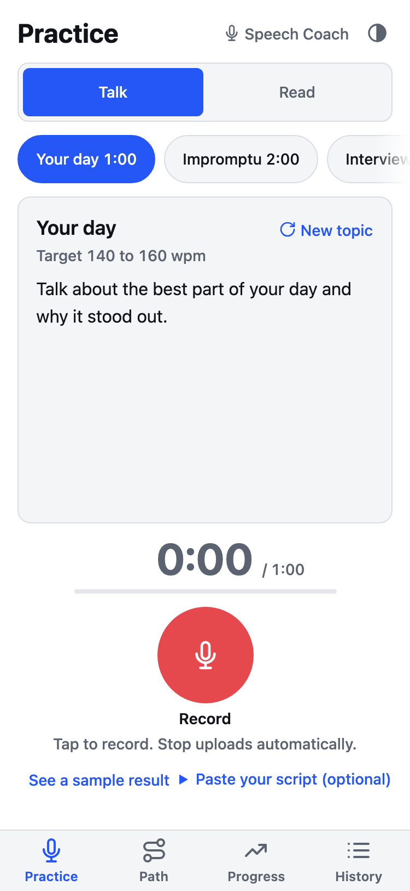
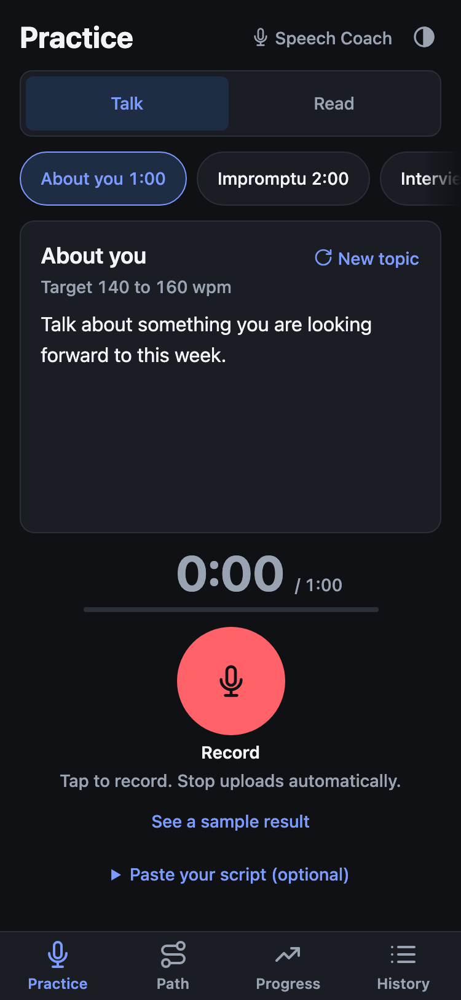
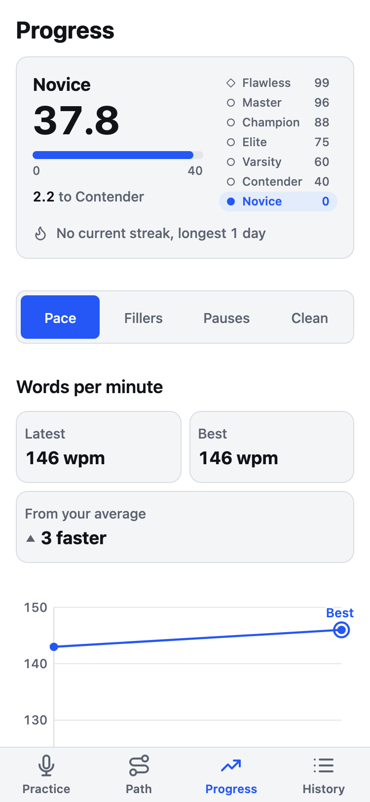
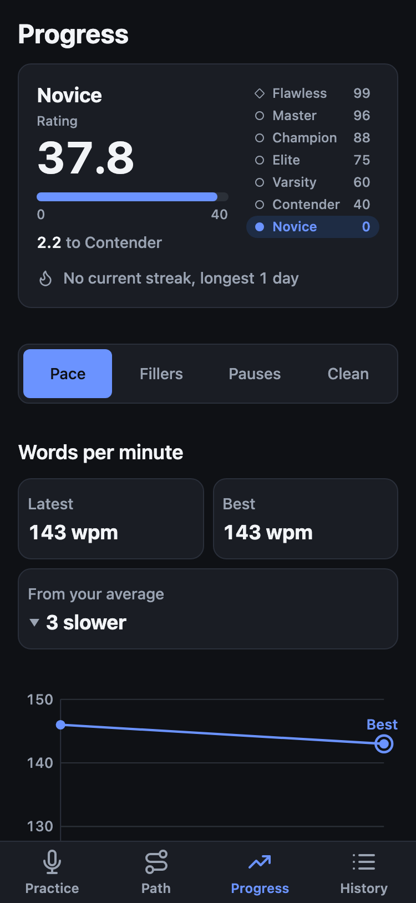
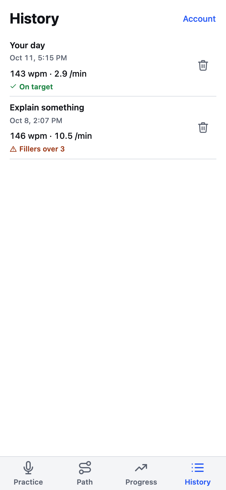
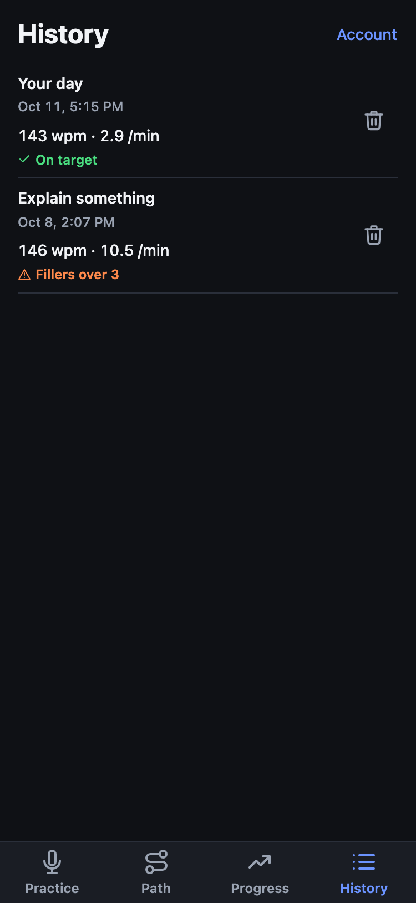
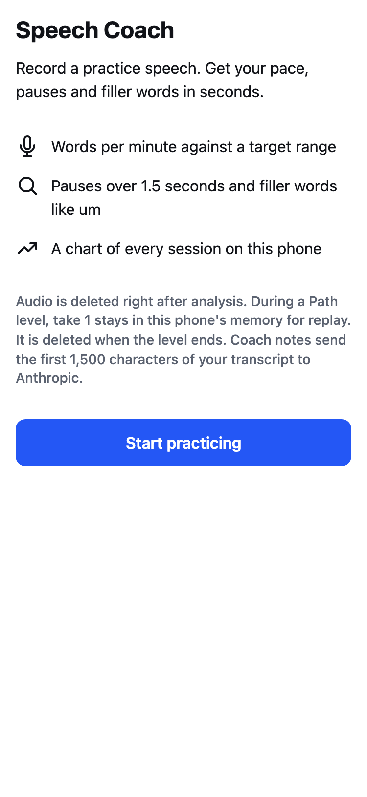
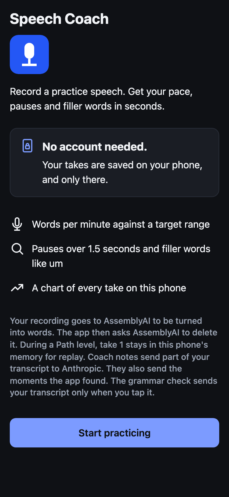
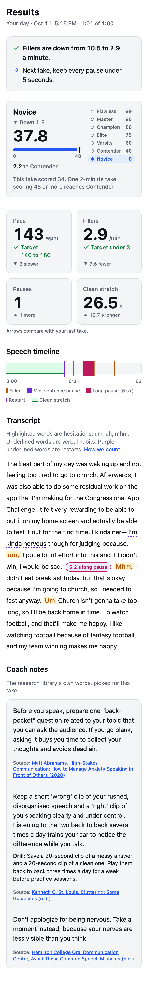
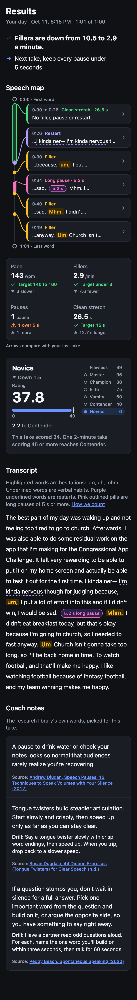

# Speech Coach (working title)
[](https://github.com/abaooba/speech-coach/actions/workflows/ci.yml)
Live app: <https://speech-coach-xz8c.onrender.com>

Talk for a minute, get your pace, your pauses, your fillers and your restarts
back in seconds, with coach notes that cite the research they come from.
Then climb a practice path built from that research.

A practice tool for speaking more fluently, for non-native speakers and
anyone who wants to sound more articulate. Record yourself talking or reading
aloud on your phone or laptop, get back words per minute, long pauses, filler
words and repeated words, and watch those numbers improve over days.
Built for the 2026 Congressional App Challenge (IL-06) by Ares Cajas.

## Screenshots

Phone width, light and dark. The history is seeded with two real takes
(`scripts/screenshot_seed.py`), so Results and Progress have something to show.

| Light | Dark |
| --- | --- |
|  |  |
|  |  |
|  |  |
|  |  |

- Practice, the home screen: pick a timed topic or a passage, tap Record, and Stop uploads
  the take.
- Results: a speech map pins each restart, freeze and filler to its second. Tap a card to
  see that moment in the transcript. Four stats, your rank, the marked transcript and two or
  three cited coach notes follow.
- Progress: one metric charted across your takes, with your latest, your best and your change
  from the average, under your rank and streak.
- History: every take, newest first, with its pace, fillers per minute and a status word.
- Onboarding, shown on first launch: what is measured and what happens to your audio.

### Results, full page





## How it works

1. The browser records audio with `MediaRecorder` and measures loudness
   with the Web Audio API to find pauses locally.
2. The audio is sent to a small FastAPI backend, which forwards it to a
   speech-to-text provider (Deepgram or AssemblyAI) with filler words kept.
3. The backend computes the metrics from the word timestamps and returns
   them with the transcript. Audio is discarded after analysis, and the
   backend asks AssemblyAI to delete its copy as soon as the words are back;
   during a Path level the browser keeps take 1 in memory for replay until
   the level ends (see Privacy below for exactly what that means).
4. The browser saves the session in IndexedDB on the device and draws a
   progress chart. No account needed: your takes stay on this device.

The longer version, with a diagram and every module's job, is
[docs/ARCHITECTURE.md](docs/ARCHITECTURE.md).

### API

`POST /api/analyze` takes a multipart form with the field `audio`, holding
the recording, and an optional field `script`, the text the take was read
from. It returns `{"transcript": [...], "metrics": {...}}` where each
transcript entry is `{"text", "start", "end"}` in seconds and `metrics` is
the dict from `backend/metrics.py`. When the take follows its script,
`metrics` also has a `script` block (restarts, skipped and misread words)
from `backend/script_align.py`.

| Status | When | Body |
| --- | --- | --- |
| 200 | Transcribed and measured | transcript and metrics |
| 400 | Empty upload, a `script` over 20,000 characters, or the last word ends before 5 s | `{"detail": message}` |
| 413 | The upload is over 40 MB, refused before it is read in full | `{"detail": message}` |
| 422 | The `audio` field is missing | FastAPI validation error |
| 502 | The speech-to-text provider is misconfigured, unreachable or failed | `{"detail": message}` |

The other routes:

| Route | What it does |
| --- | --- |
| `GET /api/health` | Liveness check that Render polls: `{"status": "ok"}` |
| `POST /api/advice` | Coach notes for one take: tips Claude Haiku writes from the tip library while `ANTHROPIC_API_KEY` is set and the server's hourly budget of AI calls lasts, the library's own words otherwise |

There are no accounts: takes stay in the browser, and `/api/advice` serves
every request the same way, by the `shown_ids` it sends.

### Stack

- Backend: Python 3.13, FastAPI, httpx, pytest
- Frontend: plain HTML, CSS and JavaScript (PWA), no framework
- Speech-to-text: AssemblyAI by default, or Deepgram; `STT_PROVIDER`
  (`assemblyai` or `deepgram`) picks one, with no automatic fallback between
  them
- Hosting: Render free tier (backend + static files)

### Repo layout

```
backend/        FastAPI app, provider clients, metrics
backend/tests/  pytest suite (network blocked)
frontend/       static PWA files served by the backend
docs/           design spec and planning notes
```

## Setup

You need Python 3.13. From the root of a fresh clone:

```bash
python3 -m venv .venv
source .venv/bin/activate
pip install -r requirements.txt -r requirements-dev.txt
cp .env.example .env   # then paste your API keys into .env
uvicorn backend.app:app --reload
```

Open http://127.0.0.1:8000 in a browser.

## Tests

Every command below runs from the repository root with the virtual
environment from Setup active.

Run the tests:

```bash
pytest
```

Lint the Python code:

```bash
ruff check .
```

Check a deploy before a demo (this one reaches the network, so pytest never runs it):

```bash
.venv/bin/python scripts/smoke_deploy.py https://speech-coach-xz8c.onrender.com
```

It prints PASS or FAIL for health and coach notes (`/api/advice` says Claude wrote them
when `ANTHROPIC_API_KEY` is set and the hourly budget lasts).

Frontend tests (plain `node:test`, no dependencies; pytest also runs them when
`node` is installed):

```bash
node --test frontend/tests
```

## Deploy to Render

The app runs as one free web service on [Render](https://render.com): the
FastAPI backend serves both the API and the static frontend, so there is
nothing else to host. `render.yaml` at the repo root describes the service.

1. Push the repo to GitHub.
2. In the Render dashboard choose **New** then **Blueprint** and connect the
   repo. Render reads `render.yaml` and proposes a web service named
   `speech-coach` (Python runtime, free plan, build `pip install -r
   requirements.txt`, start `uvicorn backend.app:app`).
3. Before you apply the Blueprint, Render asks for the secrets that
   `render.yaml` marks `sync: false`. Two are required: `ASSEMBLYAI_API_KEY`
   and `DEEPGRAM_API_KEY` (paste both; `STT_PROVIDER` is preset to
   `assemblyai`, switch it to `deepgram` under the service's **Environment**
   tab if you want the other provider). Three are optional and turn features
   on: `ANTHROPIC_API_KEY` makes Claude write the coach notes on Results
   (unset, the research library's own words stand in); `DATABASE_URL` (a
   Neon Postgres connection string) and `SESSION_SECRET` (32 random bytes,
   `python3 -c "import secrets; print(secrets.token_urlsafe(32))"`) turn
   accounts on (unset, the app is guest-only and every account route answers
   503). Setting or changing `SESSION_SECRET` signs every account out.
4. Apply. The first build takes a few minutes. Render polls the health check
   path `/api/health` and marks the deploy live once it answers 200.
5. Open the service URL (`https://speech-coach-xz8c.onrender.com`).
   Every later push to the connected branch redeploys
   automatically.

Things to know before testing or demoing on the deploy:

- **Phones need the Render URL.** Browsers only allow the microphone on
  secure origins, so `getUserMedia` works on `localhost` and on `https://`
  pages but not on a laptop's LAN address. Test on a phone by opening the
  Render URL, which is HTTPS out of the box.
- **Cold start.** The free tier spins the service down after about fifteen
  minutes without traffic, and the first open after that shows Render's own
  "Application loading" page for up to a minute. For a demo or a judging
  window, move the service to Render's Starter plan, which never sleeps. Change
  `plan: free` to `plan: starter` in `render.yaml` as well, or the next push can put
  the service back on the free plan. A pinger hitting `/api/health` every five
  minutes is the fallback. Check a
  deploy with `.venv/bin/python scripts/smoke_deploy.py <url>` (see Tests).
- **Caching.** The backend sends `Cache-Control: no-cache` for the PWA shell
  (`/`, `/index.html`, `/sw.js`, `/manifest.json`) so a new deploy shows up
  on the next open, `public, max-age=3600` for the other static files, and
  `no-store` for everything under `/api`.
- **Privacy on the deploy** is the same as described under Privacy below:
  each recording is held in memory for the duration of its request only,
  plus Starlette's transient spool file for uploads over 1 MB, which is
  deleted when the request ends. Nothing is written to the Render disk by
  the app, and the free tier's filesystem is wiped on every restart anyway.

### Install on a phone

Speech Coach is a PWA, so it can sit on the home screen and open full
screen like an app, with its own icon.

- **iPhone (Safari):** open the Render URL in Safari, tap **Share**, then
  **Add to Home Screen**, then **Add**.
- **Android (Chrome):** open the Render URL; Chrome shows an **Install**
  prompt (or choose **Install app** from the ⋮ menu).

The caching rule: the service worker (`frontend/sw.js`) caches the app's
own files, never its data. On install it stores the app shell (the page,
the stylesheet, the scripts, the manifest and the icons), so the app still
opens with no signal. Requests under `/api/` are never intercepted and never
cached: every analysis goes to the server, and the service worker stores no
recording, transcript or result. Pages and shell files are fetched from the
network first, so the service worker never holds back a new deploy while
online. Any other static file (such as `sample-session.json`) is kept after
its first load, so when one of those changes, or the `SHELL` list does, bump
`CACHE_NAME` in `sw.js` and phones drop the old copies.

## Privacy

- The backend keeps each recording in memory only for the duration of its
  request. It never saves audio under its own name, and it never logs it.
- The web framework (Starlette) parses uploads into a spooled temporary
  file: recordings up to 1 MB stay in memory, larger ones are spooled to
  the operating system's temp directory while the request runs, and the
  file is deleted when the request ends. A long recording may therefore
  touch disk for a few seconds.
- The audio is forwarded once to the speech-to-text provider you configure.
  With AssemblyAI, the default, the backend asks AssemblyAI to delete the
  transcript and the uploaded audio as soon as the words are back
  (`DELETE /v2/transcript/{id}`, which AssemblyAI documents as removing both).
  A failed delete is logged by its status alone, and the copy then expires
  under the retention setting in the AssemblyAI dashboard. With Deepgram the
  audio is subject to Deepgram's retention policy.
- During a Path level, the browser keeps take 1's recording in memory
  after its upload, so the review step can play it back. It is never
  written to IndexedDB, uploaded again or saved anywhere else, and it is
  released when the level ends: when the result shows, when you leave the
  level or start another, or when you open a screen other than Practice or
  the level. Reloading the page drops it too.
- Transcripts and metrics are returned to the browser and stored in
  IndexedDB on the device. For the coach notes on Results, the browser also
  sends the take's numbers and the first 1,500 characters of its transcript
  to `POST /api/advice`. While `ANTHROPIC_API_KEY` is set and the server's
  hourly budget of AI calls lasts, the server passes both to Anthropic so
  Claude Haiku can write the notes, and what it sends is subject to
  Anthropic's retention policy. Otherwise nothing goes to Anthropic. The
  server never logs the excerpt.

## AI disclosure

Speech-to-text is provided by a third-party API. All metric calculations,
pause detection, the user interface and the backend are hand-written.
AI coding assistants were used during development; see
[`docs/ai-disclosure.md`](docs/ai-disclosure.md) for details.

## License

[MIT](LICENSE). The research library in `backend/advice/library.json` quotes
and cites published sources; each entry names its author and link.
