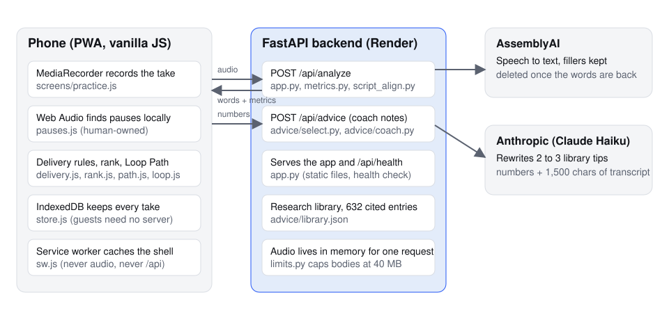

# Architecture

Speech Coach is a phone-first web app with a small Python backend. The phone
records, finds pauses, scores the take by rules it can explain, keeps every
take in its own database and draws the progress chart. The backend does the
two things a phone cannot: turn audio into timed words through a speech-to-text
provider, and ask Claude to write coach notes (and, on request, a grammar check)
for one take. There are no accounts and the server keeps nothing: every take is
saved on the phone.

## How a take becomes a score

1. Practice records with `MediaRecorder` and, in parallel, `pauses.js` reads
   loudness from the Web Audio API to find silences over 1.5 seconds. A second
   Web Audio reader, Practice's live pace capture, feeds the microphone's samples
   to `delivery.js`'s `livePace` tracker on every take. Once a take of the same
   kind (Talk or Read) has tuned the estimate, a row under the clock shows the
   estimated pace while a take records, never in a Path level; until then the
   row says when it starts. Nothing of it leaves the phone.
2. Stop posts the audio (and the script, on the Read tab) to `POST /api/analyze`.
3. The backend forwards the audio once to AssemblyAI with `disfluencies: true`,
   so "um" and "uh" come back as words with timestamps, then asks AssemblyAI
   to delete the transcript and the audio (`providers/assemblyai.py`).
4. `metrics.py` computes words per minute, fillers, pauses and repeated phrases
   from the word times. With a script, `script_align.py` lines the words up
   against it and reports restarts, skips and misreads. Both are pure functions.
5. The browser saves words and metrics in IndexedDB (`store.js`) and
   `delivery.js` re-scores every stored take by today's rules, so old takes
   never go stale when a rule changes. A take with 20 seconds of speech and 30
   words or more, not counting hesitation sounds such as um and uh, also tunes
   the live pace to the speaker's voice, unless its live capture stopped early:
   one words-a-peak factor for Talk and one for Read, kept as store flags
   (`countsForPaceFactor`, `paceFactorAfter`).
6. Results asks `POST /api/advice` for coach notes. The request carries the take's
   numbers, part of the transcript and its moments (`coach.js`: each restart,
   filler, pause, misread or unclear-word hint with its words, the words around
   it and its time). `advice/select.py` picks library entries for the weakest
   skills, `advice/coach.py` has Claude Haiku write a headline and two or three
   tips that quote those moments, and the app, not the model, attaches each
   citation. Without a key, or if the reply fails its checks, the library's own
   words stand in.
   The transcriber's word confidence marks unclear words with a dotted box and a
   "Words to check" chip. These are hints: they never enter a metric, tip or
   rank, and tapping a chip uses the phone's own voice (`speechSynthesis`).
   The Coach card's "Check grammar & vocabulary" button is the only thing that
   calls `POST /api/language-check` (`language.js`, `backend/language/check.py`),
   and only when the speaker taps it.
7. `rank.js` turns the last ten Talk takes into a rating and a tier (`language.js`
   `isReadTake` keeps takes read aloud out of it, and Progress charts them apart); `path.js`
   turns the weakest skill into the next Loop Path level.

## Modules

| Path | Owns |
| --- | --- |
| `backend/app.py` | FastAPI app: `/api/analyze`, `/api/advice`, `/api/language-check`, `/api/health`, static files, cache headers, body limits |
| `backend/metrics.py` | Pure metrics from timed words: pace, fillers, pauses, repeated phrases |
| `backend/script_align.py` | Lines a take up against its script: restarts, skipped and misread words |
| `backend/providers/` | `base.py` (the `Transcriber` protocol and `Word`), `assemblyai.py`, `deepgram.py` |
| `backend/advice/` | The research library (`library.json`, `__init__.py`), `select.py` (which entries fit a take), `coach.py` (Claude writes the notes), `budget.py` (300 AI calls an hour) |
| `backend/language/` | `check.py`: the opt-in grammar and vocabulary check (Claude Haiku, 8,000 characters at most, quotes validated against the transcript) |
| `backend/limits.py` | Request body caps (40 MB audio) answered with 413 before the body is read |
| `backend/nul_free.py` | Refuses NUL bytes in any text a route stores |
| `frontend/app.js` | The `app` namespace, hash router, boot |
| `frontend/ui.js` | DOM helpers, state blocks, icons, theme |
| `frontend/sheet.js` | The bottom sheet after a take or level, and the first-visit guides |
| `frontend/api.js` | `app.api.analyze` with a 180 s deadline and typed errors |
| `frontend/store.js` | IndexedDB sessions, flags and Path progress, on the device only |
| `frontend/passages.js` | Talk prompts, Read passages, cold reads, the benchmark |
| `frontend/delivery.js` | Filler rules, pause classes, clean stretch, restarts: the delivery report; the live pace estimate while a take records |
| `frontend/pauses.js` | Browser-side pause detection with Web Audio (human-owned) |
| `frontend/rank.js` | Take scores, the rating and the seven tiers (owner-written) |
| `frontend/rankcard.js` | The rank card on Progress and Results |
| `frontend/path.js` | The Loop Path: units, levels, rules, check-backs, crowns, the benchmark |
| `frontend/loop.js` | The Level screen's pure helpers: steps, feedback, moments, tap matching |
| `frontend/coach.js` | The take's moments for the coach and the rule-based takeaway line |
| `frontend/nextmove.js` | The one next thing to do: retry, next level, check-back, benchmark |
| `frontend/language.js` | The grammar and vocabulary check the speaker asks for on a take |
| `frontend/tips.js` | Rule-based tips and the coach-notes request |
| `frontend/sw.js` | Service worker: caches the app shell, never audio, never `/api` |
| `frontend/screens/practice.js` | Record, the live pace row, upload, level mode, the sample |
| `frontend/screens/results.js` | Coach card, speech map, metric cards, rank card, words to check, transcript |
| `frontend/screens/coachcard.js` | The Coach card at the top of Results: headline, moment-linked tips, the grammar check |
| `frontend/screens/history.js` | Every take, newest first, with delete; a take read aloud says "Read" after its date |
| `frontend/screens/progress.js` | One metric charted across takes, Talk and Read apart; the rank card and streak |
| `frontend/screens/path.js` | The winding Path with its units and nodes |
| `frontend/screens/level.js` | One Loop Path level: goal, take 1, review, take 2, result |
| `frontend/screens/onboarding.js` | First launch: what is measured, what happens to audio |

## Where data lives

| Data | Where | How long |
| --- | --- | --- |
| Audio | Phone memory while recording; backend memory for one request; AssemblyAI until the words are back | Seconds. Take 1 of a Path level stays in phone memory until the level ends |
| Words and metrics | IndexedDB on the phone only | Until the speaker deletes the take |
| Live pace factors (one number for Talk, one for Read: the store flags `livePaceFactor:talk` and `livePaceFactor:read`) | IndexedDB on the phone only | Until site data is cleared; deleting a take keeps them |
| Transcript excerpt (1,500 characters), the take's numbers and its moments | Sent to Anthropic for coach notes | Anthropic's retention policy |
| Transcript (up to 8,000 characters) | Sent to Anthropic only when the speaker taps the grammar check; nothing is saved on the server | Anthropic's retention policy |

## Why these choices

- **Rules, not a model, do the counting.** Every number on Results can be
  explained on a whiteboard (`how.html`), and the same rules re-score old takes.
- **AssemblyAI over Deepgram.** On a 30 s clip with heavy fillers, AssemblyAI
  kept 6 um and 3 uh and a restart; Deepgram kept 1 and 2 (`scripts/compare_providers.py`).
- **No framework, no build.** The app is about two dozen files a judge can read top to
  bottom. The service worker makes it installable and offline for the shell.
- **No accounts.** Nothing needs a sign-in and the server stores nothing, so a
  take lives on the phone it was recorded on.
- **The model writes prose, never facts.** Claude rewrites library entries in
  the take's numbers; the app attaches every citation from the entry itself.

## Tests

`backend/tests/` (pytest, network blocked by `pytest-socket`, providers behind
`httpx.MockTransport`) and `frontend/tests/`
(`node:test` with a hand-written fake DOM in `fake-dom.js`; modules run inside
`vm` contexts). CI runs both on every push to main and every PR.
